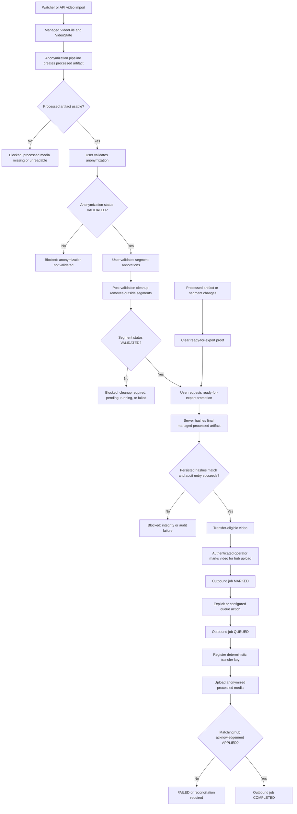

# Hub Export Workflow

Hub contract 5.0 sends persisted `patient_uuid` and `examination_uuid` values
from linked local records. The receiver preserves UUIDs and enforces source
ownership without source demographic hashes or central salts. Upgrade
`lx-dtypes`, sender and receiver together; versions 3.0 and 4.0 remain invalid.
File-integrity checksums remain allowed. Read the UUID rollout section below.
Readiness remains in endoreg-db's `feature-tracking/HubTransfer.yml`.

The same prohibition applies to browser APIs, FHIR and study spreadsheets.
The shared HTTP guard returns 409 `identity_hash_response_blocked` for identity
fields, abbreviated displays and renamed hash pseudonyms. Browser routes now use
local numeric patient/examination IDs and case UUIDs. FHIR version 2.0 and selected
case export contract 2.0 use local IDs; study workbook columns omit hashes.
Local cohort matching still uses hashes internally. Response rejection does
not roll back a completed local mutation; clients must not automatically retry
writes. See `FrontendBackendApiContracts.yml`, criterion
`identity_hash_response_boundary`.


This page defines the sender-side workflow for `lx-annotate` when a site node
exports anonymized resources to a hub deployment.

It is the local companion to the upstream hub receive contract in
`endoreg_db`. The goal is to make outbound transfer restart-safe, idempotent,
and explicit for operators in a high-stakes clinical environment.

## Scope

This workflow applies to:

- anonymized videos
- anonymized reports
- processed media transfer from a site node to a hub

This workflow does not apply to:

- the implementation details of watcher or API ingest into the local node;
  successful ingest is the prerequisite that creates the local video and its
  managed artifacts
- raw-media transfer
- the legacy annotation-segment export screen

## Core Decisions

- `center_key` is the canonical machine-facing center identifier
- transfer is permitted only for anonymized resources
- the sender exports only anonymized processed media
- import alone never makes a video transferable
- transfer is explicit: a resource must be marked for upload before it may be
  queued
- retries must reuse the same logical transfer identity

## Video Reachability From Import To Transfer

The following directed acyclic graph (DAG) separates automated import and
processing from explicit user approvals. Every gate is fail closed. Import may
create a processed artifact, but only the final green path can create and queue
an outbound transfer job.



The state can therefore be reached through normal product behavior; tests must
not manufacture `ready_for_export` directly. The reachability contract uses
the same model transitions and services as the import pipeline, segment
workflow, ready-for-export endpoint, Hub marking, and queueing code. Any later
processed-artifact replacement or segment mutation revokes the proof and sends
the video back to the readiness gate.

## Read-only operational findings, 12 October 2026

On gc-02, the application, transfer worker and certificate issuance were active,
but the two inspected failed video jobs were rejected locally before hub
registration: one lacked SensitiveMeta identity hashes; the other lacked actual
frame provenance. Both retained raw media. An authenticated mTLS status request
reached gs-02 and returned the expected not-found response for an unregistered
job. Historical applied receipts do not establish current transfer readiness.
On gc-09, certificate issuance lacked the Vault AppRole/CA files and the
application and worker were inactive; enrollment remains a separate prerequisite.
No media reset, secret change, service activation or successful replacement
transfer was performed as part of this diagnosis.

## Backfill an existing video from the overview

A terminal configuration rejection can mean that an older recording lacks
patient/examination identity metadata or actual frame provenance. Repeating the
transfer cannot create those prerequisites. The failure detail now identifies
these known conditions; operator retry validates the payload before queueing it.

In the anonymization overview, choose **Zustand reparieren**, then
**Zurücksetzen prüfen** and **Auf Import zurücksetzen**. This explicitly resets
one video's completion and approval state to the import stage. It preserves its
identity, retained files, metadata, annotations and historical evidence, and
writes an audit entry atomically with the reset. The preview changes no media state or approval.
Bulk resets and combined reset/transcode requests are rejected.

Reset requires retained raw media and refuses integrity failures, active media
operations or processing, and active or remotely registered transfers. Resolve
those blockers before retrying; do not delete transfer identities or fabricate
provenance. After reset, choose **Starten** to process the existing recording
again. This path bypasses generic-import duplicate detection. Recheck metadata,
validate anonymization and annotations, complete cleanup, and promote the final
artifact to ready for export again before retrying the existing failed transfer.
Reset alone neither regenerates evidence nor queues a transfer. The application
and the accompanying endoreg-db existing-record processing change must both be
deployed before using this workflow.

### Local verification of the backfill change

Commands run from LX-Annotate unless a repository is named:

- `PYTHONPATH=/home/admin/endoreg-db .devenv/state/venv/bin/pytest tests/hub -q --tb=short`: 229 passed, including worker, receiver and mTLS integration tests.
- `.devenv/state/venv/bin/pytest tests/api/test_video_lifecycle_readiness.py tests/api/test_video_state_repair_transcode.py tests/hub/test_hub_export_api.py tests/hub/test_publication_readiness_aaa.py -q --tb=short`: 88 passed before the additional missing-integrity regression.
- `.devenv/state/venv/bin/pytest tests/api/test_video_lifecycle_readiness.py -q --tb=short`: 37 passed after adding the missing-integrity regression.
- `npm --prefix frontend run test:unit -- --run src/components/Anonymizer/__tests__/AnonymizationOverviewRow.test.ts src/components/Anonymizer/__tests__/AnonymizationOverviewComponent.test.ts src/components/Anonymizer/__tests__/VideoBackfillRepairPanel.test.ts src/stores/__tests__/anonymizationStore.reimport.spec.ts src/components/Export/__tests__/HubExportOverviewComponent.test.ts`: 103 passed.
- `pyright lx_annotate/services/video_state_reconciliation.py lx_annotate/views/video_state_repair.py lx_annotate/hub/hub_export_jobs.py`: passed. Targeted Ruff and changed-source ESLint passed.
- Endoreg-db: `.devenv/state/venv/bin/pytest tests/views/anonymization/test_anonymization_overview.py -q --tb=short`: 64 passed, 13 skipped. Targeted workflow Pyright and Ruff passed.
- LuxNix: `.devenv/state/venv/bin/pytest tests/test_vault_fleet_enrollment.py -q`: 49 passed; `devenv tasks run docs:check`: passed.

The full hub suite with the installed endoreg-db package initially failed
collection because `clear_sensitive_meta_direct_identifiers` was absent; the
229-test result above uses the sibling source checkout explicitly. Frontend
`npm --prefix frontend run type-check:source` passed Vue/TypeScript compilation
but repository-wide ESLint remains blocked by an existing attribute-order warning
in `AnonymizationValidationComponent.vue`. No production deployment or real-media
backfill acceptance is included in these local results.

## Recoverable operator workflow

The Hub-Export **Handlungsbedarf** filter includes videos without outbound jobs.
Each video's **Nächster Schritt** comes from a structured backend assessment:
processing, anonymization review, segment review/cleanup, identity evidence,
export proof, provenance, integrity, and transport configuration are separate
concerns. Missing identity evidence or an unavailable original requires
administrator recovery; retry cannot manufacture either. Repair and review
links select the video by ID and retain a return link and the originating filters.

Stored readiness is labelled **Nachweis gespeichert**, never unconditional
approval. **Payload vorprüfen** calls
`POST /api/hub-export/videos/<id>/preflight/` using the sender's identity,
payload and provenance validators. It verifies the managed encrypted artifact
under the publication row lock and media guards, and rolls back temporary
leases. It does not approve, reset, mark, queue or change transfer history.
Its result is a point-in-time observation, invalidated by overview refresh;
marking and sending remain separate actions and the sender revalidates its
boundary. A failed preflight exposes only structured, privacy-limited reasons.
Local transport configuration is reported separately and does not prove valid
certificate lifetime, worker availability, Vault health or receiver acceptance.

A historical `completed` row is not fresh acceptance. Preflight compares the
persisted receiver receipt with the current byte-verified artifact and canonical
job identity. A mismatch requires investigation; it never rewrites or replaces
the historical transfer. The existing failed-job retry keeps the same job and
transfer key. The UI displays transfer stages, not fictitious byte percentages.

### Reviewed cleanup restart

Global administrators with the lifecycle write capability and center access can
use **Wiederherstellung untersuchen**. The
`POST /api/hub-export/videos/<id>/inspect-recovery/` endpoint uses shared cleanup
history semantics and dispatcher timeout constants. It reports task age,
configured queue, observed active/reserved/scheduled work, source availability
and media-operation guards. Progress is **unknown** when no trustworthy telemetry
exists. Missing inspection replies remain unknown; absence in replies never
proves that a broker queue or a nonresponding consumer is empty.

The explicit **Geprüften Wiederanlauf starten** action is available only for
one old pending/running history, an observed queue consumer, an unobserved task,
a retained source and no active media lease. Before confirming, the administrator
must investigate the broker and **all** consumers and affirm that the old task
is neither active nor queued. A second confirmation acknowledges that the shared
dispatcher may expire old histories and roll back extracted frame artifacts.
There is no automatic timeout restart or bulk recovery.

`POST /api/hub-export/videos/<id>/restart-cleanup/` requires the signed preview
and both boolean confirmations. The preview expires after five minutes and is
bound to the user, video, history, task ID, status and creation time. The server
locks the video, rechecks scope, preview identity, observations and operation
guards, and calls `dispatch_video_post_validation_rebuild` with the original
validated-only setting. Audit events record the review and dispatch result.
A changed history rejects replay; new activity, missing source, invalid preview,
missing confirmation or insufficient permissions stops before dispatch. A failed
response requires inspection of the resulting history rather than blind retry.
No hub transfer is created by cleanup recovery. Review the cleanup outcome and
repeat all invalidated clinical approvals before exporting.

These controls require the matching backend and frontend release. Local tests
are not acceptance on gc-02, gc-10 or gs-02, and do not repair their recordings.

Local verification on 13 October 2026 used the sibling `/home/admin/endoreg-db`
source through `PYTHONPATH`: the full Hub suite passed 242 tests, and the final
focused API suite passed 36 tests including reviewed running-history rollback
and retained-media checks. The four affected frontend suites passed 142 tests.
Vue source and Vitest type checks, targeted ESLint/Ruff, Hub Pyright, structure
lint and feature-schema validation passed. This is source-level verification,
not an installed-wheel or live-browser acceptance result.

## Marked For Upload

`marked for upload` means:

- the resource is locally approved for outbound transfer to the configured hub
- the resource is eligible for transfer under the anonymization policy
- the resource has not necessarily been queued or transferred yet

This is a local sender decision, not a remote hub status.

The mark must be:

- persisted durably
- attributable to a user or explicit system action
- reversible before queueing

For the initial implementation, the mark should be per resource. Bulk marking
is allowed as a UI convenience, but it must be implemented as repeated
per-resource state changes, not as a separate domain concept.

## Eligible Resources

Video candidate eligibility and operator marking are separate states. A video
is a transfer candidate only when all of the following are true:

- it belongs to the local sender center scope
- its managed processed artifact exists and is non-empty
- anonymization status is exactly `VALIDATED`
- segment annotation status is exactly `VALIDATED`, which includes successful
  outside-segment cleanup
- `ready_for_export` is true with an attributable actor and timestamp
- `VideoFile.processed_video_hash` and
  `VideoState.processed_file_sha256` contain the same final processed-artifact
  digest

Overview polling trusts only the persisted integrity proof and does not read
the complete video. The marking and transfer boundaries recalculate the digest
from the actual managed artifact and reject unreadable content or any mismatch.
States such as `ANONYMIZED` and `DONE_PROCESSING_ANONYMIZATION` are useful
workflow progress, but are not transfer eligible until human anonymization
validation and every later gate has completed.

An authenticated operator may then create the separate `marked` transfer
intent. Marking does not repair or bypass a failed eligibility gate.

If the local state becomes ineligible after marking, the sender must refuse to
queue or retry the transfer until the resource becomes eligible again.

## Sender State Machine

The local outbound transfer ledger should use this state model:

- `not_marked`
  The default state. No outbound transfer intent exists.
- `marked`
  Operator-approved for transfer, but not yet queued for delivery.
- `queued`
  Ready for the sender worker to attempt registration with the hub.
- `registering`
  The sender is submitting transfer metadata to the hub.
- `awaiting_media`
  The hub accepted metadata and is waiting for processed media upload.
- `uploading`
  The sender is uploading processed media to the hub.
- `completed`
  The sender has received a terminal successful hub state.
- `failed`
  The last transfer attempt failed. The resource may be retried.

Allowed transitions:

- `not_marked -> marked`
- `marked -> not_marked`
- `marked -> queued`
- `queued -> registering`
- `registering -> awaiting_media`
- `registering -> completed`
- `registering -> failed`
- `awaiting_media -> uploading`
- `awaiting_media -> failed`
- `uploading -> completed`
- `uploading -> failed`
- `failed -> queued`

Terminal behavior:

- `completed` is terminal for the current transfer intent
- any retry after `completed` must first resolve to the existing logical
  transfer, not create a new one

## Transfer Identity

The sender must compute a deterministic `transfer_key`.

Recommended shape:

- `"{source_node_key}__{resource_kind}__{resource_hash}__processed_v1"`

Required properties:

- stable across retries
- unique for a resource content hash and transfer mode
- independent of local database primary keys

This key must be reused whenever the sender retries the same logical transfer.

For videos, `resource_hash` and every `raw_video_hash` reference come from
`VideoFile.raw_video_hash`, calculated from the original input before processing
with `endoreg_db.utils.hashs.get_file_hash`. Reimport uses this same identity.
Anonymization, transcoding, and frame operations may change `processed_video_hash`,
but cannot change the raw identity or transfer key. The local lx-dtypes contract
uses `raw_video_hash` throughout; the former `video_hash` payload name is rejected.
Upgrade both transfer endpoints together.


## Transfer Mode Policy

The sender must use:

- `metadata_and_processed_media`

The sender must not use:

- `metadata_and_raw_media`
- `metadata_raw_and_processed_media`

That keeps the sender aligned with the upstream policy that only anonymized
data may be transferred.

## Retry And Reuse Rules

The sender must treat the following as idempotent reuse cases:

- the local outbound job restarts after a crash
- the metadata registration request times out and is retried
- the hub responds with an already-existing transfer for the same
  `transfer_key`
- processed media upload is retried after partial network failure

The sender must not create a new logical transfer when:

- the resource hash is unchanged
- the target node is unchanged
- the transfer mode is unchanged

A new logical transfer is required only when the transfer intent changes in a
way that would materially alter the hub-side contract, such as:

- a different target hub node
- a different resource hash
- a different transfer mode

## Sender Payload Responsibilities

Before contacting the hub, the sender must build a canonical payload that
matches the upstream transfer serializer.

At minimum, the payload must include:

- `transfer_key`
- `source_node_key`
- `target_node_key`
- `source_center_key`
- `resource_kind`
- `resource_hash`
- `transfer_mode`
- `processing_policy`
- `processing_intent`
- `cleanup_policy`
- `resource_rows`
- `processing_snapshot`

For video transfer, the sender must provide:

- `resource_rows.video_file`
- `resource_rows.video_state`
- `resource_rows.sensitive_meta` where available

For report transfer, the sender must provide:

- `resource_rows.raw_pdf_file`
- `resource_rows.raw_pdf_state`
- `resource_rows.sensitive_meta` where available

The sender must validate the payload locally before any network request is
issued.

For processed video media, local validation recalculates the Secure Hash
Algorithm 256-bit (SHA-256) digest from the actual processed artifact and
requires it to match both persisted video hash fields. The sender also requires
the declared source center to match the active source node's owning center and
requires the deterministic transfer key to match the source node, resource
kind, resource hash, and processed-media mode. Any mismatch stops before
registration, so neither metadata nor media is disclosed to the hub.

## Verified Hub Acknowledgement

Registration, status reconciliation, and media upload responses are treated as
untrusted protocol input even though the channel uses mutual Transport Layer
Security (mTLS). Every response must identify the same remote transfer, transfer
key, source node, target node, source center, resource kind, resource hash,
processed-media hash, transfer mode, and payload schema version.

The local job reaches `completed`, and local cleanup can become eligible, only
when the hub returns `applied` with this complete matching identity. A missing
or different field is a terminal acknowledgement-integrity failure; it is
persisted as `failed`, is not retried automatically, and does not permit local
cleanup.

## UI Workflow

The operator-facing export workflow should be derived from the anonymization
overview.

The new export page should:

- show anonymization readiness first
- allow marking and unmarking eligible resources
- show current outbound sender state
- keep the legacy annotation export page separate

The default filtered view should show only resources that are:

- anonymized
- locally complete enough to export
- not already completed for the current transfer intent

## Operational Requirements

Before queueing any transfer, the local node must have:

- one active local site `NetworkNode`
- one active target `central_hub` `NetworkNode`
- a configured source center scope
- a valid hub base URL
- valid node authentication material

If any of these are missing, the UI and sender worker must refuse to start
transfer work.

## Deployment And Operator Procedure

The site-node deployment must keep all credentials in mounted secret files,
not in Git, the database, or frontend configuration. A production sender uses
at least:

```sh
ENDOREG_DEPLOYMENT_ROLE=site_node
LX_ANNOTATE_HUB_EXPORT_REQUIRE_MTLS=true
LX_ANNOTATE_HUB_EXPORT_CLIENT_CERT_FILE=/run/secrets/hub-client.crt
LX_ANNOTATE_HUB_EXPORT_CLIENT_KEY_FILE=/run/secrets/hub-client.key
LX_ANNOTATE_HUB_EXPORT_CA_FILE=/run/secrets/hub-ca.crt
LX_ANNOTATE_HUB_EXPORT_RECIPIENT_PUBLIC_KEY_FILE=/run/secrets/hub-recipient.pub
LX_ANNOTATE_HUB_EXPORT_ENVELOPE_STAGING_DIR=/var/lib/lx-annotate/data/hub-export-envelopes
LX_ANNOTATE_HUB_SOURCE_NODE_SECRET_FILE=/run/secrets/hub-node-secret
LX_ANNOTATE_HUB_EXPORT_AUTO_QUEUE=false
LX_ANNOTATE_HUB_EXPORT_REQUEST_TIMEOUT_SECONDS=21600
LX_ANNOTATE_HUB_EXPORT_STALE_AFTER_SECONDS=25200
LX_ANNOTATE_HUB_EXPORT_LOCAL_CLEANUP_POLICY=retain_processed_media
```

Use the node-specific
`LX_ANNOTATE_HUB_SOURCE_NODE_SECRET_<NORMALIZED_NODE_KEY>_FILE` setting when a
deployment has more than one sender identity. Never set TLS verification to
false. The target `NetworkNode.base_url` must use `https://`.

Registration is synchronous: the hub validates and imports the complete typed
annotation graph before returning. The sender timeout and the reverse proxy's
read/send timeouts must therefore cover the largest expected annotation import
and encrypted media apply. The packaged sender and deployment example default
to 21600 seconds. Stale recovery defaults to 25200 seconds so it cannot race a
request that is still legitimately importing. A timeout is a transient transfer
failure; retry the same deterministic transfer key so the receiver can reuse
the existing ledger entry.
Redis availability does not control this synchronous HTTP registration path.

Large report registration retains the complete validated `anonymized_text`
field. Operational events record only its character count and collection row
counts, never the text itself. Processed PDF and video media remain envelope
encrypted and are uploaded as a fixed-length `application/octet-stream` body
from disk in bounded 1 MiB chunks. The `X-Hub-Media-Role` and
`X-Hub-Media-Envelope` headers carry the small, size-bounded control metadata;
multipart media uploads are not supported. Upload events include
plaintext/ciphertext byte counts, the chunk size, and request timeout so
operators can distinguish expected large-transfer latency from a stalled job.

Before enabling queueing, an authenticated operator must:

1. Open the administration overview and confirm that one active site node,
   exactly one active hub target, an HTTPS target, readable mTLS files, the
   configured certificate-authority bundle, the recipient public key, and an
   envelope staging directory inside `LX_ANNOTATE_ENCRYPTED_DATA_DIR` are
   reported ready.
2. Open the hub-export overview and confirm the displayed operator identity,
   target node, selected resource count, anonymization readiness, and privacy
   summary.
3. Mark only the reviewed resources. The overview must then show the persisted
   operator name and marking time. Do not use client-supplied actor fields.
4. Queue or enable automatic queueing only after this review. Bulk marking and
   unmarking are atomic; unmarking is allowed only while the job remains
   `marked`.
5. Follow the local job through registration, processed-media upload, and the
   verified remote `applied` acknowledgement. `awaiting_media`, `failed`, and
   `inconsistent` are not successful completion.

For a bounded recovery pass after a worker or broker outage, run:

```sh
python manage.py dispatch_hub_export_recovery --source-node-key <site-node-key>
```

This command only dispatches reconciliation. Inspect the administration
overview and the structured `lx_annotate.hub_export.audit` events afterward.
Retry exhaustion remains visible and must not be reset by changing the
`transfer_key`. A configuration or payload rejection and an acknowledgement
integrity inconsistency are terminal until an operator corrects and reviews
the cause.

Certificate rotation, hub-side proxy checks, storage-capacity response,
database-plus-media restore, quarantine handling, and the full incident
procedure are defined in the matching `endoreg_db` runbook:
`docs/hub_ingest_operations.md`. Rotate the certificate authority first, then
the client certificate and key with an overlap window; verify a complete
transfer before revoking the old identity.

During an incident, preserve the sender ledger, receiver ledger, proxy logs,
worker logs, and structured audit events. Correlate by outbound job ID,
`transfer_key`, source and target node, source center, remote transfer ID,
attempt number, acknowledgement, and cleanup decision. Do not copy secrets,
raw media, raw report text, absolute paths, or long-lived keys into tickets.
Disable the affected sender node when authentication or integrity compromise
is suspected, and resume only with the same transfer identity after the cause
has been reviewed.

The application implements the Phase 2 transfer boundary: mutual Transport
Layer Security (mTLS) authenticates and protects the channel, while every
standalone processed artifact is encrypted with a per-transfer data-encryption
key wrapped for the receiving hub. Shared secrets authenticate requests only;
the long-lived master key is never a payload-encryption substitute and never
leaves its node.

## Audit Requirements

The sender must record:

- who marked the resource for upload
- when it was queued
- when metadata registration started and finished
- when media upload started and finished
- the last failure reason
- the final sender-visible hub outcome

## Local Cleanup Policy

Sender-side cleanup is separate from hub receive-side cleanup.

The operational default is conservative:

- retain local processed artifacts after verified hub apply

An optional sender-side policy may mark local processed artifacts as
cleanup-eligible only after the hub has returned a successful terminal state.

Allowed sender policies:

- `retain_processed_media`
- `eligible_after_verified_apply`

This policy must never delete local artifacts before the sender has a verified
successful hub outcome.

The sender persists the validated typed envelope receipt with the completed
job. Reconciliation must validate and persist the same receipt; an `applied`
status without a matching receipt is an integrity failure and cannot authorize
cleanup.

Local reclamation remains a separate bounded operator action. Dry-run is the
default:

```bash
lx-annotate-manage reap_verified_hub_exports \
  --source-node-key <site-node-key> \
  --limit 100
```

After reviewing the candidate count and bytes, add `--apply` to remove only the
local processed-video object. The reaper rechecks the receipt identity,
plaintext digest and size, takes the video row lock, rejects active media leases
or processing histories, writes a durable `cleaning` marker, deletes through
the audited endoreg-db storage wrapper, clears the local `processed_file`
reference, and records `cleaned`. It never removes raw media. Processed reports
remain eligible but are not reaped because they do not yet have an equivalent
lease boundary.

## Central Hub AI Availability

The receiver atomically publishes the verified anonymized video as its managed
`VideoFile.processed_file` before returning `applied`. Central temporal
inference uses the processed frame source through
`iter_video_file_frame_samples`, which materializes that managed processed
file. When Hub storage balancing is enabled and the central copy has been moved
to protected storage, the configured remote processed-video provider retrieves
the one committed, digest-matching placement under a media lease. Site cleanup
therefore does not remove the Hub-side AI source.

## Summary

The sender-side workflow is intentionally explicit:

- processing completion plus the required human validations and persisted
  integrity proof makes a resource eligible
- operator marking authorizes export
- a local transfer ledger tracks progress
- retries reuse the same deterministic transfer identity
- only anonymized processed media is transferred

## Unresolved frame provenance

**Frame-Herkunft reparieren** opens the same recovery panel on Hub Export and the
video examination page. It is available to authenticated users in the video's
center, including ordinary users. Preview checks the current media and hash;
explicit confirmation stores an unresolved frame-mapping receipt. Available
original presentation timestamps and known recording start/end are retained in
endoreg-db. Unknown original timestamps are never inferred from frame rate.

This permits transfer of otherwise eligible usable media while recording that
future electrical-data matching is unavailable. It preserves media, annotations,
clinical approvals and immutable provenance evidence. It cannot clear a failed
outside-frame rebuild or a content-integrity failure. A replaced processed
artifact needs fresh verification and a receipt for that exact generation.

Follow the canonical [endoreg-db recovery procedure](https://github.com/wg-lux/endoreg-db/blob/main/docs/video_storage_normalization.md#recover-usable-media-with-unresolved-frame-mapping).
Deploy the shared contract, backend and frontend together on sender and receiver.

## Persistent UUID linkage (contract 5.0)

Hub transfers use `patient_uuid` and `examination_uuid` from the linked source
records, following lx-data-models. Retries preserve these UUIDs; local integer
patient IDs are never sent. Source and processed content hashes remain artifact
identifiers and integrity checks. They do not replace patient UUIDs.

Deploy matching lx-dtypes, endoreg-db and lx-annotate packages and apply
`0103_patient_examination_uuid` before enabling transfers. The hub preserves
UUIDs and rejects ownership or patient-link conflicts. Older jobs require
explicit reconciliation; no automatic version 4 fallback or identity merge is
performed. See endoreg-db's `docs/hub_transfer_typed_contract.md` and authoritative
`feature-tracking/HubTransfer.yml` for the contract and readiness evidence.

## Stored study collections

The study exchange panel uses the same `StudyExchangeBundle` as ledger Excel
exports (`mode=ledger`). The bundle contains stored observations, their original
assessments, immutable terminology snapshots, study and cohort rules, and
persistent patient/examination UUID links. Local database IDs and source identity
hashes are excluded. Definitions and historical assessment provenance remain
separate; the receiver validates both through lx-dtypes.

Before exporting an existing cohort, use **Exportabdeckung prüfen** and
**Aktuelle Kohorte im Ledger speichern** on the cohort page. The exact complete
package snapshot must already have been projected with
`import_clinical_reference_data`. Hub export and Excel export share the same
coverage check: uncaptured current cohort examinations produce HTTP 409 until
capture succeeds. Mapped spreadsheet import captures its records automatically;
validation runs capture in a transaction that is rolled back.

An authenticated study owner can select an active source site node and an optional
hub target in the panel. The explicit send action calls
`POST /api/media/studies/<study_uuid>/hub-transfer/` with `source_node_key` and,
optionally, `target_node_key`. All stored observations must be accessible and
belong to the selected source center; partial exports fail. The existing hub mTLS
configuration and node authentication apply. This metadata-only transfer needs no
attached video or report and never triggers media cleanup or processing.

The hub archives validated evidence under a deterministic source-and-content
transfer key. A retry of unchanged evidence reuses that identity. The sender
reports success only after verifying the hub's `applied` receipt against the exact
source, target, center, bundle digest and policies. Operator and transfer identity
are recorded in structured audit events; clinical payloads are not logged.

On the receiving site, a researcher explicitly accepts the returned transfer UUID
in the study exchange panel, calling
`POST /api/media/studies/hub-transfers/<transfer_uuid>/accept/` with an empty body.
Acceptance checks the researcher's current center scope and existing persistent
patient/examination UUID links before importing into that researcher's workspace.
It does not infer patient matches, assign the sender's owner, or activate imported
dataset selections. An archived definition-only bundle has no patient scope and
must use the separate authoring workflow instead of collection acceptance.

Deploy matching lx-dtypes, endoreg-db and lx-annotate versions and apply the
endoreg-db study transfer kind migration before enabling this workflow. Local
verification does not establish connectivity or authorization on a deployed hub.
